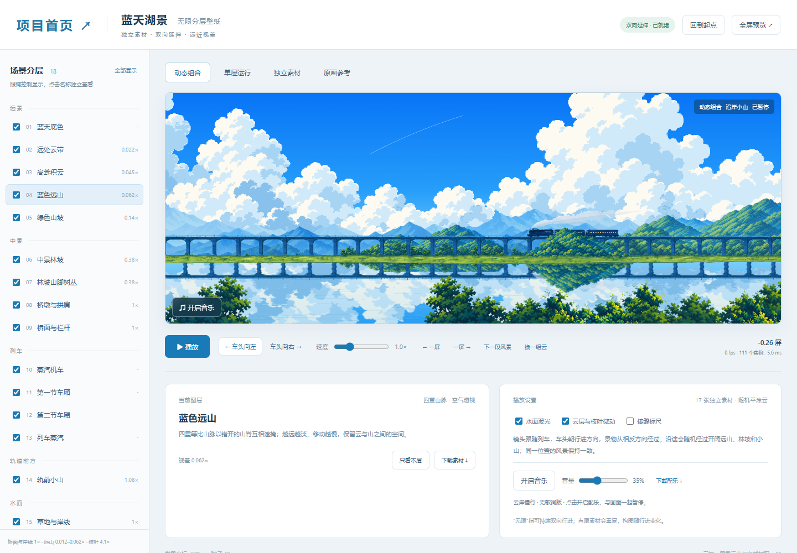

# AI Wallpaper Workshop · 分层动态壁纸

两份随项目分发的 Skill、两个真实运行案例，以及从 TA 拆解到验收导出的完整参考。

[English](README.en.md) · [快速开始](docs/GETTING-STARTED.md) · [Skill 使用方法](docs/WALLPAPER-SKILLS.md) · [制作中的关键决策](docs/DECISIONS.md)

## 最终效果

### 蓝天湖景列车 · 素材与 Shader 混合

完整透明素材组成可双向行进的世界，包含确定性视差、局部遮挡、山脚与草岸融合、选择性倒影、水波、蒸汽和枝叶微动。

### 星空列车 · 程序绘制

星空、层叠云、桥、列车、蒸汽和水面由 GLSL 实时绘制。原始主题为单文件 HTML，参数面板随主题保留。

## 开始使用

安装 Node.js 22 或更高版本，在本目录运行：

~~~sh
npm run wallpaper:doctor
npm start
~~~

打开命令打印的工作台地址。蓝天示例提供动态组合、单层运行、独立素材和原画参考四种视图；本地服务首页也提供星空案例、拆解文档和报告入口。播放已有示例无需 npm install、模型或 API Key。自动验收需要 Chrome 或 Edge。

## 两份 Skill

- [layered-wallpaper](.agents/skills/layered-wallpaper/SKILL.md)：先读取 TA 拆解与实现导航，再落实素材、视差、遮挡、Shader 和完整工作台。
- [wallpaper-quality-export](.agents/skills/wallpaper-quality-export/SKILL.md)：保存基线、保持效果优化、功能/画面/性能检查、中文 HTML 报告和离线导出。

在支持项目 Skill 的 agent 中打开本项目，使用 $layered-wallpaper 或 $wallpaper-quality-export 调用。详细输入和命令见 [使用指南](docs/WALLPAPER-SKILLS.md)。

## 保留的关键过程文档

- [TA 拆解示例](assets/blue-sky-train/ta-breakdown/2026-10-24-r01/index.html)：37 个可见图层、坐标、连接、补绘范围和静态重组对照。
- [拆解到实现导航](assets/blue-sky-train/ta-breakdown/2026-10-24-r01/navigation/index.html)：源图层到运行对象、候选代码和素材缺口的映射。
- [关键决策与常见问题](docs/DECISIONS.md)：完整素材、无限延伸、山脚接地、倒影和近景随机的取舍。
- [已测报告示例](docs/reports/latest/report.html)：真实测量、保留的固定画面、专项结果和未测范围。
- [来源与使用边界](CREDITS.md)：素材生成记录、原图提取、星空云算法及音乐来源。

拆解示例与动态蓝天案例是不同参考图；静态像素重组一致不代表隐藏背景和运动素材已经补齐。当前验收适配蓝天案例，不能为新主题或星空案例直接背书。

## 检查与导出

~~~sh
npm run check
npm test
npm run test:examples
npm run wallpaper:audit -- --out docs/verification/my-baseline
npm run wallpaper:verify-export -- --baseline docs/verification/my-baseline --out dist/my-release
~~~

每次输出使用新目录。完整验收默认 all；通过后报告位于 dist/my-release/report.html，交付包位于 dist/my-release/package/。原生 Wallpaper Engine、4K 性能、长时间运行和人工听感分别记录，未测不等于通过。

## 项目结构

~~~text
.agents/skills/    制作、验收与导出 Skill 及其脚本
cases/            蓝天案例的权威运行源码
themes/           蓝天工作台与原始星空主题
assets/           当前实际使用的素材、提示词、来源和 TA 拆解
docs/             使用指南、关键决策、效果图与报告示例
tools/            预览、构建、检查和专项验证
tests/            确定性世界与云布局测试
~~~

此发布版按实际依赖精选文件；历史实验、重复导出、录屏、音频母版、模型、缓存和本机工作记录保留在作者工作目录，不纳入此版本。清单与文件哈希见 PROJECT-MANIFEST.json。
