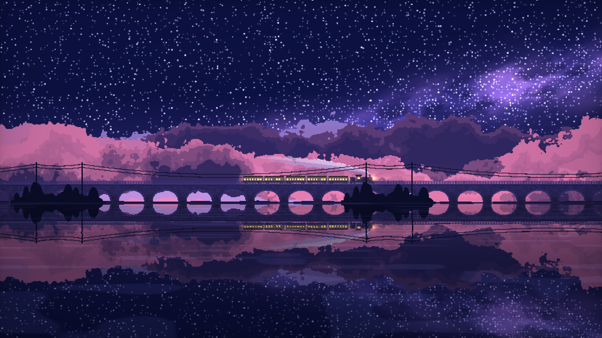
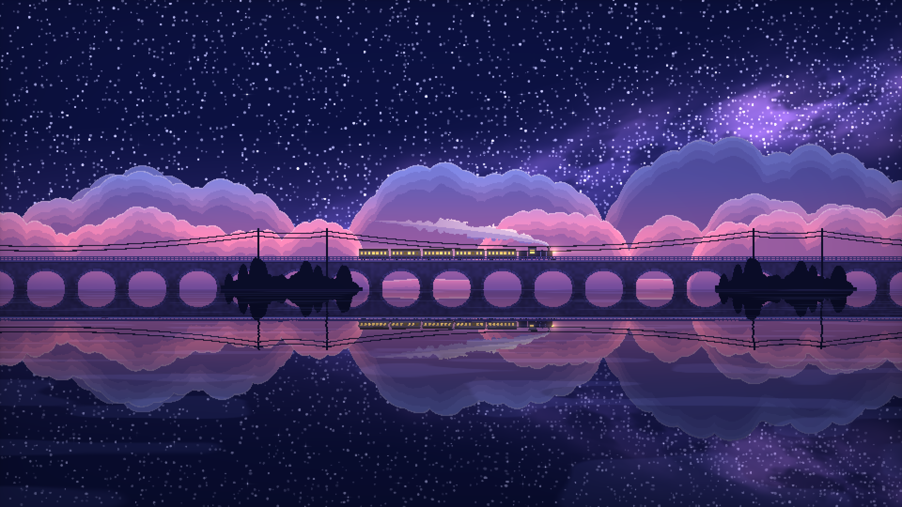

# 星河夜行列车 · 设计文档



## 1. 文件结构

```
starry-night-train/
├── index.html                       成品：单文件 WebGL 动画（HTML + CSS + JS + GLSL）
├── reference/
│   └── sunset-cloud-train.html      原版副本，仅作对照，不被 index.html 引用
└── docs/
    ├── 需求分析.md
    ├── 设计文档.md
    ├── screenshot.png               验证截图（默认镜头）
    └── screenshot-zoom.png          验证截图（镜头远近 0.5）
```

## 2. 总体架构

```
设置(settings) ──► 面板 UI（滑杆 / 开关 / 取色）──► localStorage
      │
      ▼
渲染循环 (requestAnimationFrame + 帧率上限)
  ├─ 推进运动状态：镜头偏移、列车位置、云/远岸/蒸汽偏移、车轮相位（全部取模）；列车跟随位置与穿行边界按镜头远近换算到场景坐标
  ├─ 自动降画质：统计帧间隔，持续超时则下调渲染比例
  └─ 单次全屏三角形绘制（WebGL 1，一个 fragment shader）
        └─ CSS 拉伸到窗口；像素风时 image-rendering: pixelated
降级：WebGL 不可用 → Canvas2D 简化场景
```

与原版的区别：原版是场景 pass + 后期 pass + 帧间反馈两张 FBO；星河版合并成一个 pass、不用 FBO，减少集显带宽。噪声沿用原版「预生成随机纹理」的思路，改为 256×256 纹理加单次采样的值噪声（每次 noise 只取 1 个 texel）。

## 3. 坐标与图层

- 屏幕坐标 `s = gl_FragCoord.xy / 分辨率高度`，y ∈ [0,1]，x ∈ [0, 宽高比]；屏幕中心 `c = (宽高比/2, 0.5)`。
- 场景坐标 `p = (s − c) / 镜头远近 + c + (0, 镜头高度)`，即以屏幕中心缩放再整体上下平移，与原版 `zoom` / `offset` 同义（原版 `uv.y -= offset`，这里镜头高度为正时镜头抬高、地平线下移，符号相反）。镜头远近 = 1、高度 = 0 时 `p = s`，就是原来的构图。
- 水面反射、所有图层都基于同一个 `p` 计算，所以倒影与实体始终对齐。场景本身在横向无限（全部按周期取模）、纵向向上是天空、向下是水面，缩小到 0.5 时可见范围扩大到原来的 2 倍，边缘也有内容。
- 原来按屏幕像素算的量（星点半径、电线 / 护栏 / 电线杆线宽、流星宽度、远岸灯光半径、水平线亮线）改用「每单位场景对应的像素数」：近景和中景为 `分辨率高度 × 镜头远近`（`gPx`），星空为 `分辨率高度 × √镜头远近`（`gPxS`）。
- 星空轻微视差：天空函数内把场景坐标换回屏幕坐标，再按 `√镜头远近` 缩放、镜头高度只移一半，得到星星、银河和流星的采样坐标；天空渐变和「地平线以下不画星星」仍用场景坐标。
- 地平线（水面）`H = 地平线高度参数`，默认 0.36。桥面 `H + 0.115`（shader 中的 `DECK` 宏）。
- 水面像素先求反射坐标 `q`，再调用同一个 `scene(q)`，因此每像素只算一次场景，倒影自动包含所有元素。

`scene()` 从前往后合成，累计不透明度达到 1 就提前返回，被遮挡的图层不再计算：

| 顺序 | 图层 | 视差 / 偏移来源 |
| --- | --- | --- |
| 1 | 近景树丛、电线杆、电线 | `uFore`（镜头速度 × 1.15） |
| 2 | 桥护栏 | `uCamX` |
| 3 | 蒸汽 | `uSmokeOff`（随空气） |
| 4 | 列车 | `uTrainX`（屏幕位置） |
| 5 | 石拱桥 | `uCamX` |
| 6～8 | 近 / 中 / 远三层云 | `uCloudOff.zyx`（视差 0.25 / 0.12 / 0.05，外加微风） |
| 9 | 远岸与灯光 | `uFarOff`（视差 0.08） |
| 10 | 天空：渐变、银河、星星、流星 | 静止 |

车窗光晕、车头灯和光束最后叠加。

## 4. 各元素实现

### 4.1 天空

- 渐变：`mix(地平线色, 天顶色, pow(高度, 0.6))`。
- 银河：沿一条右上倾斜的中心线做高斯光带，乘 fbm 纹理，再用另一层 fbm 挖暗尘带，整体乘 `银河亮度 × 0.7`；光带外（权重 < 0.01）跳过计算。
- 星星：两层网格哈希。小星网格 1/90，每格最多一颗，半径按像素计算，渲染比例很低时也至少有 1 个像素；亮度随 `sin(时间 × 随机频率)` 闪烁。亮星网格 1/14，带十字光芒。银河带内小星密度提高。
- 流星：两个独立槽位，周期由「流星频率」决定，每周期用哈希选起点，持续 1.1 秒，按点到线段距离画拖尾，头部有光点，首尾正弦淡入淡出。

### 4.2 云

每层云是一条一维轮廓线 `edge(x)`，像素低于轮廓就在云内。早期试过二维 fbm 高度场和一维 billow 噪声，前者会出现悬空孤岛，后者会出现尖峰，都不像积云，所以改为由圆弧拼出轮廓：

- 云底 `bank`：在 `H − 0.01` 和本层 `base` 之间按「云量」插值，再叠一点低频起伏。
- 大圆顶：噪声坐标 `x = p.x × freq + 偏移` 按 0.5 一格，每格一个圆顶，圆心有随机偏移。`聚簇 = smoothstep(噪声(cx × 1.2))`，阈值随「云量」移动，形成成团的积云和中间的空隙。圆顶在屏幕上是半圆，高度 = 半宽 = `min(A × 聚簇 × 随机 + 0.03, 0.6 / freq)`，其中 `A = amp × 云层高度`；有上限是为了只检查相邻 3 格。格号对 512 取模。
- 小鼓包：在大圆顶之上按 0.16 一格再叠一层小半圆，高度为 `半宽 × (√(1−u²) − 0.35)`，叠出菜花状顶部；只在云底以上 0.01～0.06 逐渐生效，避免云底起鼓包。格号对 1600 取模。
- 超过最大可能高度的像素直接跳过。

三层参数：

| 层 | freq | base | amp | 视差 | 初始偏移 |
| --- | --- | --- | --- | --- | --- |
| 远 | 1.1 | H + 0.04 | 0.30 | 0.05 | 11 |
| 中 | 1.6 | H + 0.06 | 0.42 | 0.12 | 3 |
| 近 | 2.4 | H + 0.08 | 0.45 | 0.25 | 7.5 |

初始偏移是用页面内复刻的噪声统计后挑出来的，让首屏可见区间落在云团较多的位置。

着色：
- 底色按高度在「云亮部（粉）」和「云顶（薰衣草蓝）」之间插值。
- 深入云内的距离加一层 billow fbm 扰动，分 4 档量化后混入「云暗部」，形成插画式团块明暗。
- 边缘 0.005 内提亮做亮边；靠近地平线混入地平线色做雾化。远层额外向天空色淡化。

### 4.3 石拱桥

- 周期 0.2，拱半宽 0.074，起拱线 `H + 0.012`，拱高按 0.8 压扁的半椭圆。
- 拱圈：距拱边 0.01 内提亮，按角度切出石缝。
- 桥面檐口两档亮边；桥身乘一次噪声做石材纹理；靠水面变暗。
- 护栏单独一层画在列车前面：立柱间距 0.016，两道横杆。

### 4.4 列车

以车头为原点 `q = (p.x − uTrainX, p.y − 桥面)`，先做包围盒剔除。

- 机车（长 0.10）：驾驶室和车顶、暖光驾驶室窗、圆角锅炉、烟箱、烟囱和帽檐、汽包、走板、排障器三角、三个大动轮和前导小轮。连杆两端随 `uWheel`（行驶距离 / 轮半径）做圆周运动。
- 煤水车（0.04）。
- 客车厢（长 0.12，间隔 0.006）：用 `floor` 直接算出当前像素属于第几节车厢，每像素只算一节。圆角车身、车顶、腰线、底架、转向架车轮（距车厢中心 ±0.036 / ±0.046）、车钩；每节 7 个车窗（间距 0.0155，宽 0.009），亮度随机，约 12% 为暗窗。
- 光晕：对整条车窗带求矩形距离，`exp(−d × 90)` 叠加；车头灯点光加前向锥形光束。
- 车身颜色按高度渐变，顶部偏亮，模拟天光。

### 4.5 蒸汽

烟囱口 `(uTrainX − 0.02, 桥面 + 0.051)`。在烟囱后方：
- 中心线 `y = 烟囱 + 0.1√dx + 0.03dx`，半径 `0.004 + 0.075 dx^0.7`，长度 `L = 0.3 + 0.45 × 蒸汽浓度`。
- 轮廓用频率 24 的 billow fbm 扰动，采样坐标用空气坐标 `p.x + uSmokeOff`，蒸汽团相对空气静止、整体缓慢上升，形成一团团的烟。
- 半径和不透明度都乘尾部淡出系数（从 0.25L 到 L），尾端自然变细消失；上亮下暗分 3 档。

### 4.6 水面

- 透视坐标 `wy = 1 / (深度 + 0.015)`，靠近地平线的波纹更密。
- 横向偏移 `off = (noise(x × 8, wy × 2.5 − t × 0.9) − 0.5) × 波纹强度 × (0.002 + 0.03 × 深度)`。
- 反射点 `q = (p.x + off, H + 深度 + off × 0.25)`；颜色乘「倒影亮度」，随深度混入深水色。
- 另一层噪声做稀疏的水平高光条纹；水平线处加一道淡亮线。

### 4.7 近景

- 岸滩按周期 1.95 出现（每周期一段约 0.55 宽）。
- 树丛：0.025 宽一格，每格一棵圆形树冠（`√(1−u²)` 轮廓），取相邻 3 格的最大值让树冠互相重叠，边缘加一点噪声毛边；高度用「格号 mod 78」哈希（0.025 × 78 = 1.95），保证随周期无缝重复。
- 电线杆：每个周期两根（周期内位置 0.15 和 0.42），高 0.24，两道横担；两道电线按抛物线下垂连接，同一段岸滩内的短跨下垂 0.01，跨到下一段的长跨下垂 0.06。线宽按像素计算。

### 4.8 后期

曝光 → 饱和度 → 暗角 → 色阶。色阶大于 1 时按色阶数量化，并加哈希抖动，配合像素风使用。

## 5. 运动与无缝循环

JS 每帧按 `dt × 行进速度` 推进，所有偏移按周期取模：

| 量 | 推进 | 取模周期 | 理由 |
| --- | --- | --- | --- |
| `camX` | 镜头跟随时 += v | 15.6 | 桥周期 0.2 × 78；护栏间距 0.016 × 975 |
| `fore` | 镜头跟随时 += 1.15v | 1.95 | 岸滩周期；树和电线杆都整除它 |
| `cloudOff[i]` | += 视差 × 频率 × v + 微风 | 256 | 噪声纹理周期；圆顶格号对 512 / 1600 取模，与 256 对齐 |
| `farOff` | += 0.08 × 3 × v | 256 | 同上；灯和房屋格号同样取模对齐 |
| `smokeOff` | 镜头跟随时 += v，外加微风 | 256 / 24 | 蒸汽噪声频率 24 |
| `trainX` | 列车穿行时 += v | 可见右边界 + 车长 + 0.1 | 驶出后从可见左边界外 0.05 处重新进入 |
| `wheel` | += v / 0.0075 | 2π | 动轮半径 |
| `t` | += dt（不乘速度） | 3600 | 闪烁、流星、波纹 |

## 6. 性能策略

| 手段 | 说明 |
| --- | --- |
| 单 pass、无 FBO | 省掉原版的反馈纹理读写 |
| 单次采样值噪声 | 每个 noise 1 次纹理读取 |
| 前到后合成并提前返回 | 被桥、列车、近景、厚云挡住的部分不算天空和远层云 |
| 包围盒剔除 | 云、列车、蒸汽、桥、银河先做范围判断 |
| 渲染比例默认 0.5 + 像素风 | 默认像素数是全分辨率的 1/4，最近邻放大本身就是像素画风格 |
| dpr | 像素风开启时按 CSS 像素（dpr = 1），像素块大小不随系统缩放变化；关闭时 dpr 上限 1.5 |
| 噪声细节 1～6 阶 | 默认 4 |
| 帧率上限 | 默认 60，可降到 20；按时间预算（下一帧应绘制的时刻）跳帧，高刷屏上也能准确限到目标帧率 |
| 自动降画质 | 每 2 秒统计一次，忽略超过 250ms 的间隔（后台限速、卡顿），样本不少于 10 个且平均帧间隔超过目标 1.6 倍时，渲染比例 × 0.85（下限 0.25） |
| 页面隐藏停帧 | `visibilitychange` 取消 rAF，恢复时重置计时避免跳帧 |
| 精度 | 片元支持 highp 时用 highp，否则 mediump；所有偏移已取模，数值保持较小 |

## 7. 参数表

滑杆参数（默认值对应参考图）：

| 键 | 名称 | 范围 | 默认 |
| --- | --- | --- | --- |
| speed | 行进速度 | 0～1 | 0.12 |
| zoom | 镜头远近（大于 1 拉近，小于 1 拉远） | 0.5～2 | 1 |
| camY | 镜头高度（正值抬高镜头、看到更多天空） | −0.3～0.3 | 0 |
| stars | 星星密度 | 0～1 | 0.55 |
| twinkle | 闪烁强度 | 0～1 | 0.6 |
| milky | 银河亮度 | 0～2 | 1 |
| meteor | 流星频率 | 0～1 | 0.35 |
| cloud | 云量 | 0～1.5 | 0.9 |
| cloudH | 云层高度 | 0.3～1.6 | 1 |
| steam | 蒸汽浓度 | 0～1.5 | 1 |
| cars | 车厢数量 | 1～10 | 5 |
| win | 车窗亮度 | 0～2 | 1 |
| glow | 光晕强度 | 0～2 | 1 |
| horizon | 地平线高度 | 0.25～0.5 | 0.36 |
| refl | 倒影亮度 | 0～1.2 | 0.85 |
| ripple | 波纹强度 | 0～2 | 1 |
| exposure | 曝光 | 0.4～2 | 1 |
| saturation | 饱和度 | 0～2 | 1.1 |
| vignette | 暗角 | 0～1 | 0.45 |
| poster | 色阶（0 为关闭） | 0～32 | 0 |
| scale | 渲染比例 | 0.25～1 | 0.5 |
| detail | 噪声细节 | 1～6 | 4 |
| fps | 帧率上限 | 20～60 | 60 |

开关：镜头跟随（开）、像素风（开）、自动降画质（开）、暂停（关）。

颜色（10 项）：天顶 `#0d1240`、地平线 `#4a3c8c`、云亮部 `#ff8fbd`、云顶 `#8f97f0`、云暗部 `#4b3f8f`、车窗 `#ffd27a`、车身 `#1d1a3a`、桥体 `#2a2554`、远处灯光 `#ffb35c`、近景剪影 `#0b0d26`。

## 8. 面板交互

- 右下角面板，点标题栏折叠/展开；按 `H` 键整体隐藏或显示。
- 标题栏显示实时帧率和渲染分辨率。
- 每项滑杆旁有「重置」；颜色用原生 `<input type="color">`（离线可用，比原版自绘取色器简单）。
- 底部按钮：恢复默认、记住设置（localStorage，键 `starry-night-train:v1`）、清除记录。
- 自动降画质改动渲染比例时同步更新滑杆。

## 9. 降级与容错

- `getContext('webgl')` 失败（再试 `experimental-webgl`）或 shader 编译失败：顶部显示提示，切换到 Canvas2D 简化版（渐变天空、固定随机星星闪烁、拱桥、列车循环行驶、水面倒影用翻转后再画一遍桥和列车）。
- 降级版同样支持镜头：`translate(中心) → scale(镜头远近) → translate(−中心 + 镜头高度 × 高)`；先算出未缩放坐标下的可见矩形，天空、水面、桥身和拱洞都铺满这个矩形，星点尺寸除以缩放保持 1 像素。
- `webglcontextlost`：阻止默认行为并停帧；`webglcontextrestored` 时重建 GL 资源。
- localStorage 读写包在 try/catch 中，读到的值逐项校验和夹取范围。

## 10. 验证方法

1. 浏览器打开页面，确认 `gl.getError() == 0`、没有降级提示；间隔 4 秒截图两次，对比桥拱、近景和云的位置，同时读取运动状态（镜头偏移应增加 4 × 行进速度）。
2. 用无头 Edge 直接以 `file:///D:/AIGame/AIGame/starry-night-train/index.html` 打开，通过 DevTools 协议收集控制台日志和帧率，分两种情况：
   - `--use-angle=swiftshader`：纯 CPU 软件渲染，模拟最差的无独显情况，观察自动降画质是否收敛；
   - `--disable-webgl`：确认显示中文提示并切到 Canvas2D 简化版。
3. 最终截图存为 `docs/screenshot.png`，即本文开头插图。

结果：

| 环境 | 结果 |
| --- | --- |
| RTX 3080（ANGLE D3D11），960×540 渲染 | 60 fps，GL 无错误；4 秒内镜头偏移 2.494 → 2.974（+0.48 = 4 × 0.12） |
| SwiftShader 软件渲染，`file://` 打开 | 控制台无日志；渲染比例自动从 0.5 降到 0.35 后稳定在约 40 fps |
| 禁用 WebGL，`file://` 打开 | 显示降级提示，仅一条预期的 warning；Canvas2D 简化版 60 fps 持续行驶 |
| 镜头参数（RTX 3080） | 镜头远近 0.5 / 1 / 2、镜头高度 ±0.3 逐一截图，GL 无错误，倒影对齐、边缘无空白；远近 0.5 加高度 −0.3 并关闭镜头跟随时，列车在 −0.906 处重新进场（可见左边界 −0.889） |
| 镜头参数（禁用 WebGL） | 远近 0.5 加高度 0.2、远近 2 加高度 −0.2，Canvas2D 画面铺满、60 fps |

镜头远近 0.5 的画面：


