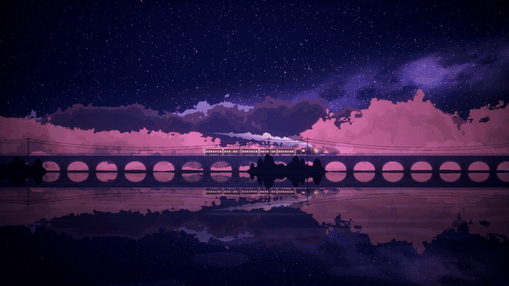

# 星河夜行列车 · Starry Night Train

一列蒸汽小火车在星空下驶过石拱桥，粉紫色的云层层后退，水面倒映着星河与车窗的暖光。

整个场景由**一个零依赖的单文件 HTML** 实时渲染：没有图片素材、没有第三方库，所有画面都由一个 WebGL fragment shader 逐像素计算出来。它改编自 [落日云间列车 sunset-cloud-train](https://github.com/incarnation-gem/sunset-cloud-train)，把晚霞云海换成了星河夜景。

[](https://github.com/Be1Human/starry-night-train/releases/tag/v1.0)

## 视频与在线演示

- **完整视频**（3 分 53 秒，1080p 30fps，配乐《Letter from the Clouds》）：[下载 starry-night-train.mp4](https://github.com/Be1Human/starry-night-train/releases/download/v1.0/starry-night-train.mp4)
- **短视频**：[10 秒](https://github.com/Be1Human/starry-night-train/releases/download/v1.0/starry-night-train-10s.mp4) · [5 秒](https://github.com/Be1Human/starry-night-train/releases/download/v1.0/starry-night-train-5s.mp4)
- **在线演示**：<https://be1human.github.io/starry-night-train/>（右下角面板可以实时调参，按 `H` 隐藏界面）


## 运行

下载 `index.html`，用 Chrome 或 Edge 双击打开即可，离线可用。

- 右下角面板共 30 多项参数，分为运动、镜头、夜空、云与蒸汽、列车、水面、后期、画质、颜色几组，每项都可以单独重置，也可以把设置记到浏览器里。
- 没有独显也能跑：默认半分辨率渲染加像素风放大；持续掉帧时会自动降低渲染比例和噪声细节。
- 浏览器不支持 WebGL 时，自动切换为 Canvas2D 简化版。

## 实现方法

### Wallpaper Engine 网页壁纸

`../../dist/starry-night-train/` 是原版动画的独立壁纸包，保留原版层级云，不包含 `experiments/` 中的圆云实验。默认隐藏网页界面，提供 40 项 Wallpaper Engine 设置（运动、镜头、夜空、云、列车、水面、画质、颜色与面板显示）。帧率遵循 Wallpaper Engine 全局设置，最高 60 fps；暂停后停止绘制，恢复时重置计时，避免画面跳跃。壁纸设置由 Wallpaper Engine 保存，启动时不读取网页旧存档。

在项目目录运行 `node tools/build-wallpaper.mjs` 可从原版 `index.html` 重新生成壁纸包。将整个 `../../dist/starry-night-train/` 文件夹复制到 Wallpaper Engine 的 `projects/myprojects/` 下，在软件中选择「星河夜行列车 · Starry Night Train」即可使用。不要导入整个仓库，以免带入视频产物。

适配检查：启动前参数回调、颜色转换、零值与部分更新、参数边界、面板开关、全局 24 fps 限帧、暂停停止绘制与恢复动画均通过无头 Edge 验证，WebGL 无错误。桌面版本的配置已确认指向安装的网页文件，网页渲染进程已启动；尚未逐项人工检查 Wallpaper Engine 设置栏。

完整设计见 [docs/设计文档.md](docs/设计文档.md)，需求见 [docs/需求分析.md](docs/需求分析.md)。下面是要点。

### 1. 单个 pass 的全屏 shader

画面只有一次全屏三角形绘制，所有元素都在同一个 fragment shader 里按像素计算。原版需要场景 pass、后期 pass 加两张帧间反馈 FBO，这里合并成一个 pass，省掉了集显上最贵的显存带宽。

`scene(p)` 从前往后合成图层，累计不透明度到 1 就提前返回，被挡住的部分不再计算：

| 顺序 | 图层 | 视差 |
| --- | --- | --- |
| 1 | 近景树丛、电线杆、电线 | 镜头速度 × 1.15 |
| 2 | 桥护栏 | 镜头速度 |
| 3 | 蒸汽 | 随空气漂移 |
| 4 | 列车 | 固定在画面中偏右 |
| 5 | 石拱桥 | 镜头速度 |
| 6 | 远岸与灯光 | 0.08 |
| 7 | 12 层云 | 镜头速度 × 5 / 层距离 |
| 8 | 天空：渐变、银河、星星、流星 | 静止 |

水面像素先算出反射坐标，再调用同一个 `scene()`，所以倒影自动包含桥、列车、云和星空，并且始终和实体对齐。

### 2. 云：12 层 fbm 高度场

云的算法移植自原版：每层云是一个二维 fbm 噪声的高度场

```
h = (fbm(x + 偏移ᵢ, y) − 0.5) × dispᵢ × 起伏 + midlevelᵢ
```

因为 fbm 的输入里包含 y，轮廓是二维噪声的等值线，所以会出现碎裂的边缘、悬空的小云块和孔洞。每层再按深度切出 2～4 道色带，12 层由近到远叠加。原版的晚霞色按亮暗关系映射到星河配色（云亮部、云顶、云暗部）。

形状与原版一致，性能上做了两处不改变结果的优化：

- 预先把噪声纹理每个格点的 2×2 平均值存进纹理，用一次硬件双线性采样代替原版的 4 次取值加手工插值；
- fbm 每算完一阶，就用剩余权重乘噪声的上下限，推出最终值的范围，确定盖不到当前像素或一定落在最深色带时提前退出。

云量、云层高度只调整各层的 midlevel，把云压到画面中下部、上方留出星空；越远的层越向天空色靠拢，融进夜色。

### 3. 其他元素

- **星空**：两层网格哈希，小星每格最多一颗、随机频率闪烁，亮星带十字光芒；银河是倾斜的高斯光带乘 fbm，再用另一层 fbm 挖出暗尘带；流星用点到线段的距离画拖尾。
- **列车**：以车头为原点用 SDF 拼出机车（锅炉、烟囱、汽包、驾驶室、排障器、动轮和连杆）、煤水车和客车厢。用 `floor` 直接算出当前像素属于第几节车厢，每个像素只算一节。车窗亮度随机，车窗带外有指数衰减的光晕。
- **蒸汽**：沿抛物线中心线展开，半径随距离增大，用 billow fbm 扰动轮廓；采样坐标跟随空气而不是列车，所以烟团留在原地慢慢上升。
- **水面**：透视坐标 `1 / (深度 + 0.015)`，越靠近地平线波纹越密，用噪声横向扰动反射坐标。
- **镜头**：场景坐标 `p = (s − c) / 远近 + c + (0, 高度)`，所有图层和倒影共用同一套变换；原来按屏幕像素计算的线宽和星点半径改为按「每单位场景的像素数」计算，缩放时粗细不变。

### 4. 无缝循环与性能

- 所有滚动量都按各自周期取模（桥 15.6、近景 1.95、云 1024、远岸 256），长时间运行既没有浮点精度问题，也没有接缝跳变。
- 默认渲染比例 0.5 加最近邻放大，像素数只有全分辨率的 1/4，最近邻放大本身就是像素画风格。
- 自动降画质每 2 秒统计一次帧间隔，按「渲染比例 → 噪声细节 → 渲染比例下限」的顺序逐级下调。在纯 CPU 的 SwiftShader 软件渲染下，约 24 秒收敛到 21 fps 左右。
- 页面隐藏时停帧；WebGL 上下文丢失后会自动重建。

## 视频是怎么做的

视频不是录屏，而是逐帧确定性渲染出来的，所以不会掉帧。只用了 Edge、Node 和 ffmpeg，没有 npm 依赖。

```bash
# 1. 逐帧录制原始画面（1920×1080，30 fps）
node tools/record-video.mjs --seconds 233.9 --camy-to 0.06 --out ../../export/starry-night-train/raw.mp4
# 2. 后期合成并配乐
node tools/compose-video.mjs --video ../../export/starry-night-train/raw.mp4 --audio <音乐.mp3> --out ../../export/starry-night-train/星河夜行列车.mp4
```

**录制**（[tools/record-video.mjs](tools/record-video.mjs)）：用 Node 自带的 `WebSocket` 直接走 DevTools 协议，控制无头 Edge。在页面脚本执行前替换 `requestAnimationFrame` 和 `performance.now`，换成虚拟时钟，每步精确推进 1/30 秒，与实际渲染耗时无关。每帧在同一次 `Runtime.evaluate` 里完成「设置镜头 → 推进一帧 → `canvas.toDataURL`」，JPEG 数据直接写进 ffmpeg 的标准输入。镜头在开头 14 秒内用 smoothstep 从远近 1 拉到 0.5。

**合成**（[tools/compose-video.mjs](tools/compose-video.mjs)）：一张 ffmpeg 滤镜图完成全部后期：

- 泛光：只保留高光，缩小到 480×270 后模糊再放大，用滤色叠加回原图；
- 暗角、细微的胶片颗粒；
- 片头标题和片尾小字：在透明画布上写黑字再模糊，得到柔和阴影；
- 黑场淡入淡出、音频淡入淡出；
- 色彩：把 JPEG 帧的 BT.601 全范围统一转成 BT.709 TV 范围，避免播放器偏色。

## 来源与许可

- 改编自 [incarnation-gem/sunset-cloud-train](https://github.com/incarnation-gem/sunset-cloud-train)，该项目提取自 [Rice-dog/code-codex](https://github.com/Rice-dog/code-codex) 的「Cloud Train Background」插件（MIT）。面板交互和渲染循环的思路参考了原版。
- **云的生成算法**（噪声、fbm、12 层高度场与色带合成）移植自原版 shader，作者 **mdb**。该 shader 没有附带再分发许可，本项目沿用上游仓库的声明：**仅供学习与欣赏，请勿商用；如果权利人认为不妥，联系后会立即下架。**
- 夜空、石拱桥、列车、蒸汽、水面、近景、远岸以及视频工具都是重新编写的。
- `reference/sunset-cloud-train.html` 是原版的未改动副本，仅用于对照。

壁纸音乐：随包附带《Letter from the Clouds》，默认循环播放、音量 35%，可在 Wallpaper Engine 设置中关闭或调节，随引擎暂停与恢复。构建默认从 ../../assets/starry-night-train/audio/music.mp3 读取音乐，可通过 --audio <配乐.mp3> 替换。
