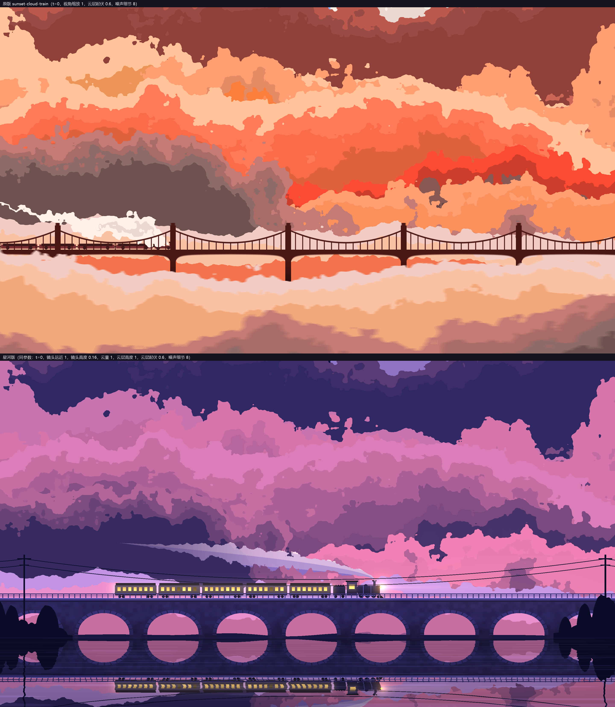
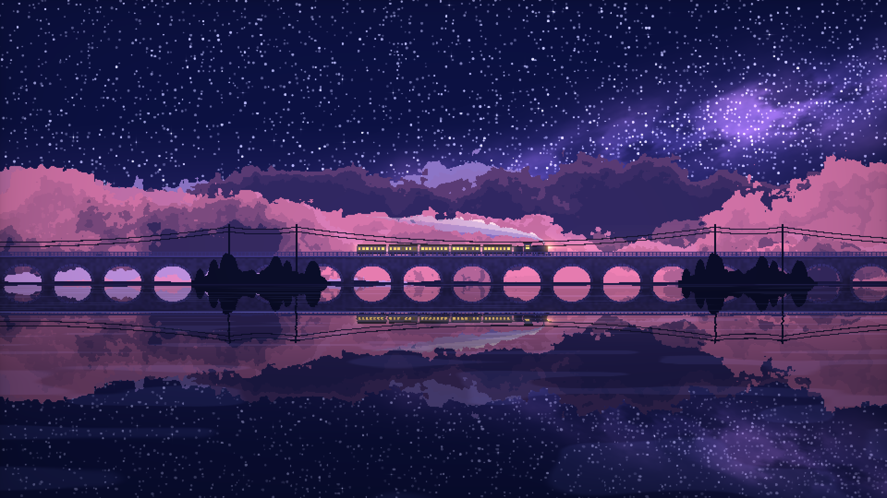

# 星河夜行列车 · 设计文档

> 以下保留原项目设计与发布记录；文中的旧目录树属于历史记录。当前目录以 [新项目说明](../../../README.md) 为准，图片与音乐已集中到 assets/starry-night-train/。


## 1. 文件结构

```
starry-night-train/
├── README.md                        发布说明：预览、视频、运行与实现方法、许可（见第 12 节）
├── index.html                       成品：单文件 WebGL 动画（HTML + CSS + JS + GLSL）
├── reference/
│   └── sunset-cloud-train.html      原版副本，仅作对照，不被 index.html 引用
├── tools/
│   ├── record-video.mjs             视频导出：无头 Edge 逐帧录制原始画面（见第 11 节）
│   └── compose-video.mjs            视频导出：后期合成与配乐
├── export/                          视频产物（原始画面、成片、预览帧），已加入 .gitignore，不入库
└── docs/
    ├── 需求分析.md
    ├── 设计文档.md
    ├── preview.gif                  README 动图预览（成片 60～65 秒，720 宽、10 fps）
    ├── screenshot.png               验证截图（默认镜头：远近 0.5、高度 0.06）
    ├── screenshot-zoom.png          验证截图（镜头远近 0.5）
    └── cloud-compare.png            云形状对比（上原版、下星河版）
```

## 2. 总体架构

```
设置(settings) ──► 面板 UI（滑杆 / 开关 / 取色）──► localStorage
      │
      ▼
渲染循环 (requestAnimationFrame + 帧率上限)
  ├─ 推进运动状态：镜头偏移、列车位置、云/远岸/蒸汽偏移、车轮相位（全部取模）；列车跟随位置与穿行边界按镜头远近换算到场景坐标
  ├─ 自动降画质：统计帧间隔，持续超时则下调渲染比例
  └─ 单次全屏三角形绘制（WebGL 1，一个 fragment shader）
        └─ CSS 拉伸到窗口；像素风时 image-rendering: pixelated
降级：WebGL 不可用 → Canvas2D 简化场景
```

与原版的区别：原版是场景 pass + 后期 pass + 帧间反馈两张 FBO；星河版合并成一个 pass、不用 FBO，减少集显带宽。除云以外的图层用 256×256 随机纹理加单次采样的值噪声；云用与原版完全相同的 1024×1024 噪声纹理和噪声函数（见 4.2）。

来源与许可：云的生成算法（噪声、fbm、12 层深度高度场与色带合成）移植自原版 shader，作者 mdb，经 [incarnation-gem/sunset-cloud-train](https://github.com/incarnation-gem/sunset-cloud-train)（commit `c00934d`）获得。该 shader 没有再分发许可，本项目按上游仓库的做法公开发布：仅供学习欣赏、不商用，权利人认为不妥即下架；`index.html` 顶部注释和 README 都写明了这一点。其余图层为重新编写。

## 3. 坐标与图层

- 屏幕坐标 `s = gl_FragCoord.xy / 分辨率高度`，y ∈ [0,1]，x ∈ [0, 宽高比]；屏幕中心 `c = (宽高比/2, 0.5)`。
- 场景坐标 `p = (s − c) / 镜头远近 + c + (0, 镜头高度)`，即以屏幕中心缩放再整体上下平移，与原版 `zoom` / `offset` 同义（原版 `uv.y -= offset`，这里镜头高度为正时镜头抬高、地平线下移，符号相反）。镜头远近 = 1、高度 = 0 时 `p = s`，就是原来的构图。
- 水面反射、所有图层都基于同一个 `p` 计算，所以倒影与实体始终对齐。场景本身在横向无限（全部按周期取模）、纵向向上是天空、向下是水面，缩小到 0.5 时可见范围扩大到原来的 2 倍，边缘也有内容。
- 原来按屏幕像素算的量（星点半径、电线 / 护栏 / 电线杆线宽、流星宽度、远岸灯光半径、水平线亮线）改用「每单位场景对应的像素数」：近景和中景为 `分辨率高度 × 镜头远近`（`gPx`），星空为 `分辨率高度 × √镜头远近`（`gPxS`）。
- 星空轻微视差：天空函数内把场景坐标换回屏幕坐标，再按 `√镜头远近` 缩放、镜头高度只移一半，得到星星、银河和流星的采样坐标；天空渐变和「地平线以下不画星星」仍用场景坐标。
- 地平线（水面）`H = 地平线高度参数`，默认 0.36。桥面 `H + 0.115`（shader 中的 `DECK` 宏）。
- 水面像素先求反射坐标 `q`，再调用同一个 `scene(q)`，因此每像素只算一次场景，倒影自动包含所有元素。

`scene()` 从前往后合成，累计不透明度达到 1 就提前返回，被遮挡的图层不再计算：

| 顺序 | 图层 | 视差 / 偏移来源 |
| --- | --- | --- |
| 1 | 近景树丛、电线杆、电线 | `uFore`（镜头速度 × 1.15） |
| 2 | 桥护栏 | `uCamX` |
| 3 | 蒸汽 | `uSmokeOff`（随空气） |
| 4 | 列车 | `uTrainX`（屏幕位置） |
| 5 | 石拱桥 | `uCamX` |
| 6 | 远岸与灯光 | `uFarOff`（视差 0.08） |
| 7 | 12 层云（由近到远，命中即不透明返回） | `uCL[i]`（镜头速度 × 5 / dist，外加微风） |
| 8 | 天空：渐变、银河、星星、流星 | 静止 |

车窗光晕、车头灯和光束最后叠加。

## 4. 各元素实现

### 4.1 天空

- 渐变：`mix(地平线色, 天顶色, pow(高度, 0.6))`。
- 银河：沿一条右上倾斜的中心线做高斯光带，乘 fbm 纹理，再用另一层 fbm 挖暗尘带，整体乘 `银河亮度 × 0.7`；光带外（权重 < 0.01）跳过计算。
- 星星：两层网格哈希。小星网格 1/90，每格最多一颗，半径按像素计算，渲染比例很低时也至少有 1 个像素；亮度随 `sin(时间 × 随机频率)` 闪烁。亮星网格 1/14，带十字光芒。银河带内小星密度提高。
- 流星：两个独立槽位，周期由「流星频率」决定，每周期用哈希选起点，持续 1.1 秒，按点到线段距离画拖尾，头部有光点，首尾正弦淡入淡出。

### 4.2 云

云忠实移植自原版 `background()` 里的 c12～c1 共 12 层（来源与许可见第 2 节）。对比截图（上为原版，下为星河版，同为 t = 0、镜头远近 1、云层起伏 0.6、噪声细节 8；星河版的云量和云层高度设为 1，镜头高度设为 0.16，使云坐标与原版 uv 完全重合）：



**噪声**（与原版一致）：
- 纹理：1024×1024，xorshift（种子 93451）逐字节生成，线性过滤、重复寻址。
- `noise(x)`：五次插值 `u = f³(f(6f − 15) + 10)`，取 4 个整数格点 `(p + {0,1}²)/1024` 的纹理值做双线性组合。格点坐标正好落在 texel 边界上，线性过滤得到的是相邻 2×2 texel 的平均值。
- 实现上做了等价变换：初始化时预先算出每个格点的 2×2 平均值存进纹理（四个字节之和为 0～1020，亮度通道存和 >> 2，alpha 通道存低 2 位 × 64，着色器里用 `亮度 + alpha / 256` 还原出精确平均值），再用一次硬件双线性采样 `(floor(x) + u + 0.5)/1024` 代替原版的 4 次取值加手工插值，结果相同。
- `fbm(x)`：`噪声细节` 阶，每阶权重 × 0.7、频率 × 2，除以权重和归一化。每阶坐标对 1024 取模（噪声周期），只为防止坐标过大丢精度，不改变结果。

**分层高度场**（与原版一致）：每层 `h = (fbm(x + 偏移_i, y) − 0.5) × disp_i × 云层起伏 + midlevel_i`。fbm 的输入包含 y，所以轮廓是二维噪声的等值线，会出现原版那种碎裂的边缘、悬空的小云块和孔洞。每层再按 `dh` 从深到浅切出 2～4 道色带：`y < h − dh` 就取该色带颜色并不透明返回，与原版 `layer(dh, v)` 宏相同。各层 midlevel、disp、dist、初始偏移和色带 dh 全部照搬原版：

| 层（原版编号） | midlevel | disp | dist | 初始偏移 | 色带 dh |
| --- | --- | --- | --- | --- | --- |
| c12 | 0.30 | 0.9 | 10 | 32.5 | 0.14 / 0.1 / 0.07 / 0 |
| c11 | 0.35 | 1.0 | 15 | 30 | 0.04 / 0 |
| c10 | 0.35 | 3.5 | 20 | 27.5 | 0.12 / 0.08 / 0.04 / 0 |
| c9 | 0.45 | 2.0 | 25 | 23 | 0.04 / 0 |
| c8 | 0.50 | 2.3 | 30 | 20.5 | 0.12 / 0.08 / 0.04 / 0 |
| c7 | 0.50 | 2.5 | 35 | 18 | 0.1 / 0.05 / 0 |
| c6 | 0.60 | 2.0 | 40 | 18 | 0.1 / 0 |
| c5 | 0.75 | 3.5 | 45 | 15.5 | 0.2 / 0.15 / 0.1 / 0 |
| c4 | 0.70 | 2.7 | 50 | 12 | 0.04 / 0 |
| c3 | 0.80 | 2.7 | 60 | 9.5 | 0.1 / 0 |
| c2 | 0.90 | 3.0 | 70 | 7 | 0.1 / 0.05 / 0 |
| c1 | 1.00 | 5.0 | 100 | 3.5 | 0.1 / 0 |

**与星河版的衔接**：
- 云坐标 `y_c = p.y − H + 0.2`，即地平线对应原版的 y = 0.2，c12 落在地平线和桥面之间，相对桥的位置和原版一致。x 直接用场景坐标，因此镜头远近、镜头高度、水面反射都自动正确。
- 滚动：原版各层为 `t / dist`、桥为 `t / 5`，所以星河版每层偏移按「镜头位移 × 5 / dist」推进，外加一点微风，每层单独对 1024 取模（见第 5 节）。
- 云量与云层高度只改各层 midlevel，不改单层形状：`midlevel' = 0.3 + (midlevel − 0.3) × 云层高度 + (云量 − 1) × 0.3`。两者都为 1 时与原版相同；默认 0.7 / 0.4，把云压到画面中下部，上方留出星空。
- 合成顺序：近景、护栏、蒸汽、列车、桥、远岸之后，按 c12 → c1 由近到远判断，命中即返回，最后才是天空。

**配色**：原版每道色带的晚霞色按亮暗关系映射到星河版的三种云颜色。亮度 `l` 从 0.3 到 0.72，在「云暗部 × 0.7」和「云亮部」之间过渡；又亮又不饱和的颜色（原版的奶油色）再最多向「云顶」混合 70%；整体乘 `0.78 + 0.3 l`。原版里深层的暗色带、云顶的亮边，以及各层之间的明暗关系都因此保留下来。另外按层序加了最多 33% 的「夜色雾化」，越远的层越向天空色靠拢，这一步原版没有，用来让远层融进夜空。

**提前退出**（不改变结果）：
- 纹理里的噪声值有确定的最小值和最大值，初始化时算出来作为 `uNMin` / `uNMax`。像素高于 `midlevel' + (uNMax − 0.5) × disp'` 时，这层一定盖不到，直接跳过。
- fbm 每算完一阶，就用剩余权重乘噪声上下限，得到最终值的范围。如果已经能确定这层盖不到当前像素，或者一定落在最深的色带里，就提前结束。

**未移植的部分**：
- 原版 `foreground()` 的 c14、c13 两层前景云：它们在桥下形成云海，会盖住星河版的水面和倒影。
- 原版的 5 次时间采样运动模糊、帧间反馈拖影（0.3），以及原版的地面、桥、列车、烟。

### 4.3 石拱桥

- 周期 0.2，拱半宽 0.074，起拱线 `H + 0.012`，拱高按 0.8 压扁的半椭圆。
- 拱圈：距拱边 0.01 内提亮，按角度切出石缝。
- 桥面檐口两档亮边；桥身乘一次噪声做石材纹理；靠水面变暗。
- 护栏单独一层画在列车前面：立柱间距 0.016，两道横杆。

### 4.4 列车

以车头为原点 `q = (p.x − uTrainX, p.y − 桥面)`，先做包围盒剔除。

- 机车（长 0.10）：驾驶室和车顶、暖光驾驶室窗、圆角锅炉、烟箱、烟囱和帽檐、汽包、走板、排障器三角、三个大动轮和前导小轮。连杆两端随 `uWheel`（行驶距离 / 轮半径）做圆周运动。
- 煤水车（0.04）。
- 客车厢（长 0.12，间隔 0.006）：用 `floor` 直接算出当前像素属于第几节车厢，每像素只算一节。圆角车身、车顶、腰线、底架、转向架车轮（距车厢中心 ±0.036 / ±0.046）、车钩；每节 7 个车窗（间距 0.0155，宽 0.009），亮度随机，约 12% 为暗窗。
- 光晕：对整条车窗带求矩形距离，`exp(−d × 90)` 叠加；车头灯点光加前向锥形光束。
- 车身颜色按高度渐变，顶部偏亮，模拟天光。

### 4.5 蒸汽

烟囱口 `(uTrainX − 0.02, 桥面 + 0.051)`。在烟囱后方：
- 中心线 `y = 烟囱 + 0.1√dx + 0.03dx`，半径 `0.004 + 0.075 dx^0.7`，长度 `L = 0.3 + 0.45 × 蒸汽浓度`。
- 轮廓用频率 24 的 billow fbm 扰动，采样坐标用空气坐标 `p.x + uSmokeOff`，蒸汽团相对空气静止、整体缓慢上升，形成一团团的烟。
- 半径和不透明度都乘尾部淡出系数（从 0.25L 到 L），尾端自然变细消失；上亮下暗分 3 档。

### 4.6 水面

- 透视坐标 `wy = 1 / (深度 + 0.015)`，靠近地平线的波纹更密。
- 横向偏移 `off = (noise(x × 8, wy × 2.5 − t × 0.9) − 0.5) × 波纹强度 × (0.002 + 0.03 × 深度)`。
- 反射点 `q = (p.x + off, H + 深度 + off × 0.25)`；颜色乘「倒影亮度」，随深度混入深水色。
- 另一层噪声做稀疏的水平高光条纹；水平线处加一道淡亮线。

### 4.7 近景

- 岸滩按周期 1.95 出现（每周期一段约 0.55 宽）。
- 树丛：0.025 宽一格，每格一棵圆形树冠（`√(1−u²)` 轮廓），取相邻 3 格的最大值让树冠互相重叠，边缘加一点噪声毛边；高度用「格号 mod 78」哈希（0.025 × 78 = 1.95），保证随周期无缝重复。
- 电线杆：每个周期两根（周期内位置 0.15 和 0.42），高 0.24，两道横担；两道电线按抛物线下垂连接，同一段岸滩内的短跨下垂 0.01，跨到下一段的长跨下垂 0.06。线宽按像素计算。

### 4.8 后期

曝光 → 饱和度 → 暗角 → 色阶。色阶大于 1 时按色阶数量化，并加哈希抖动，配合像素风使用。

## 5. 运动与无缝循环

JS 每帧按 `dt × 行进速度` 推进，所有偏移按周期取模：

| 量 | 推进 | 取模周期 | 理由 |
| --- | --- | --- | --- |
| `camX` | 镜头跟随时 += v | 15.6 | 桥周期 0.2 × 78；护栏间距 0.016 × 975 |
| `fore` | 镜头跟随时 += 1.15v | 1.95 | 岸滩周期；树和电线杆都整除它 |
| `cl[i]`（12 层云） | += (镜头位移 + 0.01 dt) × 5 / dist_i | 1024 | 云噪声纹理周期，fbm 各阶频率为 2 的幂，仍整除 |
| `farOff` | += 0.08 × 3 × v | 256 | 256 噪声纹理周期；灯和房屋格号同样取模对齐 |
| `smokeOff` | 镜头跟随时 += v，外加微风 | 256 / 24 | 蒸汽噪声频率 24 |
| `trainX` | 列车穿行时 += v | 可见右边界 + 车长 + 0.1 | 驶出后从可见左边界外 0.05 处重新进入 |
| `wheel` | += v / 0.0075 | 2π | 动轮半径 |
| `t` | += dt（不乘速度） | 3600 | 闪烁、流星、波纹 |

## 6. 性能策略

| 手段 | 说明 |
| --- | --- |
| 单 pass、无 FBO | 省掉原版的反馈纹理读写 |
| 单次采样值噪声 | 每个 noise 1 次纹理读取；云噪声用预平均纹理把原版的 4 次取值等价成 1 次 |
| 云层提前退出 | 按噪声上下限推 fbm 取值范围，确定不命中或必落最深色带时提前结束，结果不变 |
| 前到后合成并提前返回 | 被桥、列车、近景、厚云挡住的部分不算天空和远层云 |
| 包围盒剔除 | 云、列车、蒸汽、桥、银河先做范围判断 |
| 渲染比例默认 0.5 + 像素风 | 默认像素数是全分辨率的 1/4，最近邻放大本身就是像素画风格 |
| dpr | 像素风开启时按 CSS 像素（dpr = 1），像素块大小不随系统缩放变化；关闭时 dpr 上限 1.5 |
| 噪声细节 1～8 阶 | 默认 8，与原版一致；云 fbm 用满全部阶数，银河、蒸汽等其他 fbm 最多 6 阶 |
| 帧率上限 | 默认 60，可降到 20；按时间预算（下一帧应绘制的时刻）跳帧，高刷屏上也能准确限到目标帧率 |
| 自动降画质 | 每 2 秒统计一次，忽略超过 250ms 的间隔（后台限速、卡顿），样本不少于 10 个且平均帧间隔超过目标 1.6 倍时降一级：先把渲染比例 × 0.85 降到 0.35，再把噪声细节逐阶降到 5，最后才把渲染比例降到下限 0.25 |
| 页面隐藏停帧 | `visibilitychange` 取消 rAF，恢复时重置计时避免跳帧 |
| 精度 | 片元支持 highp 时用 highp，否则 mediump；所有偏移已取模，数值保持较小 |

## 7. 参数表

滑杆参数（默认值对应参考图；镜头默认值取视频成片的最终构图，见下）：

| 键 | 名称 | 范围 | 默认 |
| --- | --- | --- | --- |
| speed | 行进速度 | 0～1 | 0.12 |
| zoom | 镜头远近（大于 1 拉近，小于 1 拉远） | 0.5～2 | 0.5 |
| camY | 镜头高度（正值抬高镜头、看到更多天空） | −0.3～0.3 | 0.06 |
| stars | 星星密度 | 0～1 | 0.55 |
| twinkle | 闪烁强度 | 0～1 | 0.6 |
| milky | 银河亮度 | 0～2 | 1 |
| meteor | 流星频率 | 0～1 | 0.35 |
| cloudCover | 云量（整体升降各层 midlevel，1 = 原版） | 0～1.5 | 0.7 |
| cloudStack | 云层高度（按层间距压缩各层 midlevel，1 = 原版） | 0.1～1 | 0.4 |
| amplitude | 云层起伏（乘各层 disp，同原版 amplitude） | 0～2 | 0.6 |
| steam | 蒸汽浓度 | 0～1.5 | 1 |
| cars | 车厢数量 | 1～10 | 5 |
| win | 车窗亮度 | 0～2 | 1 |
| glow | 光晕强度 | 0～2 | 1 |
| horizon | 地平线高度 | 0.25～0.5 | 0.36 |
| refl | 倒影亮度 | 0～1.2 | 0.85 |
| ripple | 波纹强度 | 0～2 | 1 |
| exposure | 曝光 | 0.4～2 | 1 |
| saturation | 饱和度 | 0～2 | 1.1 |
| vignette | 暗角 | 0～1 | 0.45 |
| poster | 色阶（0 为关闭） | 0～32 | 0 |
| scale | 渲染比例 | 0.25～1 | 0.5 |
| detail | 噪声细节（同原版 detail） | 1～8 | 8 |
| fps | 帧率上限 | 20～60 | 60 |

开关：镜头跟随（开）、像素风（开）、自动降画质（开）、暂停（关）。

默认值与视频的关系：`tools/record-video.mjs` 录制时设置了 `scale 1`、`auto false`、`fps 60`、`paused false`、`follow true`，镜头在 14 秒内从 `zoom 1、camY 0` 过渡到 `zoom 0.5、camY 0.06`（第 11 节命令里的 `--camy-to 0.06`），之后一直保持。成片最终状态中，这些画面参数的去留如下：

- 照搬为默认值：`zoom 0.5`、`camY 0.06`。
- 本来就与默认值相同：`fps 60`、`paused false`、`follow true`。
- 不照搬：`scale 1` 和 `auto false`。它们只是为了保证录制画质（固定 1920×1080、不让自动降画质改分辨率），实时播放时仍用 0.5 和自动降画质，照顾集显。

`compose-video.mjs` 只做后期（泛光、暗角、颗粒、文字、淡入淡出），不涉及页面参数。

颜色（10 项）：天顶 `#0d1240`、地平线 `#4a3c8c`、云亮部 `#ff8fbd`、云顶 `#8f97f0`、云暗部 `#4b3f8f`、车窗 `#ffd27a`、车身 `#1d1a3a`、桥体 `#2a2554`、远处灯光 `#ffb35c`、近景剪影 `#0b0d26`。

## 8. 面板交互

- 右下角面板，点标题栏折叠/展开；按 `H` 键整体隐藏或显示。
- 标题栏显示实时帧率和渲染分辨率。
- 每项滑杆旁有「重置」；颜色用原生 `<input type="color">`（离线可用，比原版自绘取色器简单）。
- 底部按钮：恢复默认、记住设置（localStorage，键 `starry-night-train:v2`）、清除记录。
- 存储版本：默认镜头改为成片构图后，键从 `v1` 升到 `v2`。旧的 `v1` 存档不迁移，启动时直接删除。原因是旧存档里几乎都带着旧的 `zoom 1、camY 0`；若迁移，新默认构图对老用户永远不会生效，而改默认的目的正是让所有人看到新构图。旧存档里能保留的只有少量手调参数，重新调一次的代价很小。`v2` 期间曾短暂存在过云增强的三个参数（已撤回），`v2` 存档里的这些键读取时按「只认当前参数表里的键」直接忽略，所以 `v2` 不必再升级。
- 旧存储兼容：读取时只认当前参数表里的键并夹取范围。旧版的 `cloud` / `cloudH` 语义已变，改用新键名 `cloudCover` / `cloudStack` / `amplitude`，所以旧值会被忽略，这几项取新默认值；旧存储里的 `detail` 仍有效。
- 自动降画质改动渲染比例或噪声细节时同步更新滑杆。

## 9. 降级与容错

- `getContext('webgl')` 失败（再试 `experimental-webgl`）或 shader 编译失败：顶部显示提示，切换到 Canvas2D 简化版（渐变天空、固定随机星星闪烁、拱桥、列车循环行驶、水面倒影用翻转后再画一遍桥和列车）。
- 降级版同样支持镜头：`translate(中心) → scale(镜头远近) → translate(−中心 + 镜头高度 × 高)`；先算出未缩放坐标下的可见矩形，天空、水面、桥身和拱洞都铺满这个矩形，星点尺寸除以缩放保持 1 像素。
- `webglcontextlost`：阻止默认行为并停帧；`webglcontextrestored` 时重建 GL 资源。
- localStorage 读写包在 try/catch 中，读到的值逐项校验和夹取范围。

## 10. 验证方法

1. 浏览器打开页面，确认 `gl.getError() == 0`、没有降级提示；间隔 4 秒截图两次，对比桥拱、近景和云的位置，同时读取运动状态（镜头偏移应增加 4 × 行进速度）。
2. 用无头 Edge 直接以 `file:///D:/AIGame/AIGame/starry-night-train/index.html` 打开，通过 DevTools 协议收集控制台日志和帧率，分两种情况：
   - `--use-angle=swiftshader`：纯 CPU 软件渲染，模拟最差的无独显情况，观察自动降画质是否收敛；
   - `--disable-webgl`：确认显示中文提示并切到 Canvas2D 简化版。
3. 最终截图存为 `docs/screenshot.png`，即本文开头插图。

结果：

| 环境 | 结果 |
| --- | --- |
| RTX 3080（ANGLE D3D11），960×540 渲染 | 60 fps，GL 无错误；4 秒内镜头偏移 2.494 → 2.974（+0.48 = 4 × 0.12） |
| SwiftShader 软件渲染，`file://` 打开（移植原版云之前） | 控制台无日志；渲染比例自动从 0.5 降到 0.35 后稳定在约 40 fps |
| SwiftShader 软件渲染，`file://` 打开（移植原版云之后） | 控制台无日志；比例 0.5 时约 5 fps，自动降到 0.35 约 12 fps，细节降到 5 阶后比例再降到 0.25，稳定在约 21 fps（24 秒内收敛） |
| 原版云（RTX 3080），960×540 渲染 | 60 fps，GL 无错误；镜头远近 0.5 / 2、镜头高度 ±0.3 截图无错位，倒影对齐 |
| 原版云（禁用 WebGL） | Canvas2D 简化版不含云，60 fps 照常运行 |
| 禁用 WebGL，`file://` 打开 | 显示降级提示，仅一条预期的 warning；Canvas2D 简化版 60 fps 持续行驶 |
| 镜头参数（RTX 3080） | 镜头远近 0.5 / 1 / 2、镜头高度 ±0.3 逐一截图，GL 无错误，倒影对齐、边缘无空白；远近 0.5 加高度 −0.3 并关闭镜头跟随时，列车在 −0.906 处重新进场（可见左边界 −0.889） |
| 镜头参数（禁用 WebGL） | 远近 0.5 加高度 0.2、远近 2 加高度 −0.2，Canvas2D 画面铺满、60 fps |
| 存储版本 | 新键 `starry-night-train:v2`；旧键 `v1` 启动时被删除，默认即读到远近 0.5、高度 0.06 |

镜头远近 0.5 的画面：



## 11. 视频导出

对应需求分析第 7 节。分两步：`tools/record-video.mjs` 逐帧录制原始画面，`tools/compose-video.mjs` 做后期合成并配乐。分开的好处是调整后期时不必重新渲染画面。

```
node tools/record-video.mjs --seconds 233.9 --camy-to 0.06 --out export/raw.mp4
node tools/compose-video.mjs --video export/raw.mp4 --audio <音乐.mp3> --out export/星河夜行列车.mp4
```

### 11.1 逐帧录制（record-video.mjs）

- 启动无头 Edge（`--headless=new --use-angle=d3d11`，使用独显；全新的临时 user-data-dir，避免 localStorage 里的旧设置），用 Node 自带的 `fetch` / `WebSocket` 直接走 DevTools 协议，不依赖 puppeteer。
- `Emulation.setDeviceMetricsOverride` 设为 1920×1080、deviceScaleFactor 1；`prefers-reduced-motion` 强制为 `no-preference`，避免速度被减半。
- 虚拟时钟：`Page.addScriptToEvaluateOnNewDocument` 在页面脚本执行前替换 `requestAnimationFrame` / `cancelAnimationFrame` / `performance.now`。rAF 回调只进队列，脚本每帧调用 `__snt.step(1000/30)` 把虚拟时间推进 33.3 ms 并执行回调，页面的 `frame(now)` 因此每帧都得到精确的 dt = 1/30 秒，与实际渲染耗时无关。
- 页面设置：`S.scale = 1`（像素风下按 CSS 像素，画布正好 1920×1080，启动时校验）、`S.auto = false`、`S.fps = 60`（帧率上限的间隔 16.7 ms 小于每步 33.3 ms，限帧逻辑不会跳帧）、`S.paused = false`、`S.follow = true`；给 body 加 `ui-hidden` 隐藏面板和标题（帧率显示在面板内一并隐藏）。先预热 60 帧，让列车跟随位置稳定。
- 取帧：WebGL 上下文没开 `preserveDrawingBuffer`，绘图缓冲在合成后会被清空，所以「设置镜头 → 推进一帧 → `canvas.toDataURL('image/jpeg', 0.95)`」放在同一次 `Runtime.evaluate` 里完成。返回的 base64 解码后写入 ffmpeg 标准输入（`-f image2pipe -c:v mjpeg -framerate 30`），编码为 libx264 CRF 10 的中间文件；写入遇到背压时等待 `drain`。
- 镜头时间线：`k = smoothstep(t / 14)`，`zoom = 1 + (0.5 − 1) k`，`camY = 0 + (0.06 − 0) k`，14 秒后保持最远 0.5。拉远后地平线在画面中部略偏上、上方星空和银河占三分之一左右，构图已较均衡；镜头高度只轻微上调 0.06，给标题多留一点星空。
- 录制时长比音乐多 0.5 秒余量，合成时按音乐时长截断。`--shots` 可在指定秒数另存 JPEG，`--no-video` 只推进不取帧，用于快速看构图。

### 11.2 后期合成（compose-video.mjs）

一次 ffmpeg 滤镜图完成，顺序如下：

| 步骤 | 滤镜 | 参数与理由 |
| --- | --- | --- |
| 泛光 | `split` → `curves`（0.5 以下压黑，只留高光）→ 缩到 480×270 → `gblur σ=5` → 放大 → `blend screen` | 不透明度 0.55。只取高光，车窗、灯光、亮云周围出现柔光，暗部星空不发灰；缩小后再模糊，等效大半径且速度快 |
| 暗角 | `vignette=angle=PI/5` | 轻微压暗四角，视线集中到桥和列车 |
| 颗粒 | `noise=c0s=4:c0f=t+u` | 只加在亮度上的时变均匀噪声，细微胶片感，不偏色 |
| 文字阴影 | 透明画布 `color=black@0` 上用同样的位置和透明度写黑字，再 `gblur σ=7`，向下偏 3 像素叠加 | drawtext 自带的阴影是硬边，这样得到柔和阴影 |
| 文字 | `drawtext` | 标题「星　河　夜　行　列　车」（全角空格拉开字距）微软雅黑 Light 66 px，透明度 0.92，4～6 秒淡入、9.5～11 秒淡出；副标题「Letter from the Clouds」Georgia Italic 30 px，透明度 0.78，5～7 秒淡入、9.8～11.2 秒淡出；两者位于画面上方 13% 处的星空里，水平居中。片尾小字「愿每一段夜路，都有星光同行」34 px，结束前 13～10.5 秒淡入、5.5～3.5 秒淡出 |
| 淡入淡出 | `fade in 0～3 秒`、`fade out 最后 5 秒` | 黑场开、黑场收 |
| 音频 | `afade in 2 秒`、`afade out 最后 5 秒` | AAC 320 kbps、48 kHz |

色彩：原始帧来自 JPEG，是 BT.601 全范围，直接编码会被标成 `yuvj420p`，部分播放器和平台转码会偏色。泛光叠加后用 `scale=out_color_matrix=bt709:out_range=tv` 转成 BT.709 TV 范围，末尾 `setparams` 写入 bt709 / tv 标记，编码参数同时带 `-colorspace bt709 -color_primaries bt709 -color_trc bt709 -color_range tv`。

编码：libx264 `-preset slow -crf 16 -profile:v high -pix_fmt yuv420p -r 30 -movflags +faststart`（可选 `--encoder nvenc` 改用 h264_nvenc p7 / cq 16）。`--limit` 只输出前若干秒，淡出与片尾文字仍按完整时长排布，用来出样片。drawtext 的字体路径在滤镜图里要把盘符冒号转义成 `C\:/Windows/Fonts/...`；透明度表达式放在单引号里，内部逗号无需转义。

### 11.3 验证结果

先用 12 秒样片抽帧检查标题位置、泛光、阴影和颗粒（第一版标题在画面 30% 高度处压在云顶上，改到 13% 处的星空里），再渲染全片。全片用提交 `e73125b`（移植原版云）的 `index.html` 渲染。录制脚本显式设置镜头时间线，与页面默认镜头无关，所以默认值改成 0.5 / 0.06 不影响录制结果。

| 项 | 结果 |
| --- | --- |
| 环境 | 无头 Edge，ANGLE D3D11，RTX 3080；页面内校验画布 1920×1080、渲染比例 1、噪声细节 8，`document.hidden` 为 false |
| 录制 | 7017 帧，约 11.5 帧/秒，用时约 8.6 分钟；中间文件 CRF 10，约 935 MB |
| 合成 | libx264 slow，约 20 帧/秒，用时约 6 分钟 |
| 成片 ffprobe | H.264 High，1920×1080，30 fps，7000 帧，yuv420p / bt709 / tv；AAC LC 48 kHz 立体声；时长 233.33 秒（音频 233.32 秒）；约 427 MB，视频码率约 15 Mbps |
| 抽帧 | 7.5 秒标题清晰、位于星空区；11.5 秒拉远接近完成；120 秒列车在桥上行驶、云形持续变化；224 秒片尾小字；最后 5 秒淡出到黑 |

已知限制：ffmpeg 自带 AAC 编码器按 320 kbps 目标编码，实测平均约 275 kbps；画面中的运动、流星、闪烁都按虚拟时间推进，与实际渲染速度无关。

## 12. 公开发布

对应需求分析第 8 节。

| 项 | 做法 |
| --- | --- |
| 仓库 | `gh repo create Be1Human/starry-night-train --public --source . --push`，推送 `master` 分支 |
| README | 根目录 `README.md`，内嵌 `docs/preview.gif`，实现方法从本文档第 2～6、11 节摘要，详细内容链接回本文档 |
| 动图 | `ffmpeg -ss 60 -t 5`，`fps=10,scale=720:-1`，`palettegen max_colors=128 stats_mode=diff` + `paletteuse dither=bayer`，约 4 MB（800 宽、12 fps 时约 10.6 MB，太大） |
| 视频 | `gh release create v1.0`，附件为成片（233 秒）、10 秒、5 秒三个 mp4；附件名改成英文（`starry-night-train.mp4` 等），避免下载链接里出现百分号编码 |
| 在线演示 | `gh api repos/Be1Human/starry-night-train/pages -X POST` 设为 `master` 分支根目录；`index.html` 是零依赖单文件，无需构建 |

不入库：`export/`（视频产物）、`prototypes/`（未定稿的原型）。
